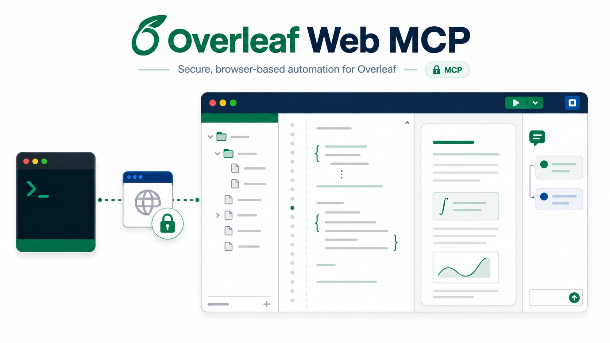

<h1 align="center">Overleaf Web MCP</h1>

<p align="center"><strong>Read, edit, compile, and review your Overleaf projects, signed in as you,<br>from Claude, Codex, Cursor, or any MCP client, or from a shell or a TypeScript program.</strong></p>

<p align="center">
  <a href="https://mhmdaskari.github.io/overleaf-web-mcp/"><strong>Docs</strong></a> &nbsp;·&nbsp;
  <a href="#get-started"><strong>Get started</strong></a> &nbsp;·&nbsp;
  <a href="#without-an-mcp-client"><strong>Command line</strong></a> &nbsp;·&nbsp;
  <a href="#tools"><strong>Tools</strong></a> &nbsp;·&nbsp;
  <a href="#how-it-keeps-your-project-safe"><strong>Safety</strong></a> &nbsp;·&nbsp;
  <a href="#how-it-compares"><strong>Compare</strong></a> &nbsp;·&nbsp;
  <a href="https://mhmdaskari.github.io/overleaf-web-mcp/changelog/"><strong>Changelog</strong></a>
</p>

<p align="center">
  <a href="https://www.npmjs.com/package/overleaf-web-mcp"></a>
  <a href="https://www.npmjs.com/package/overleaf-web-mcp"></a>
  <a href="https://github.com/mhmdaskari/overleaf-web-mcp/actions/workflows/ci.yml"></a>
  
  <a href="#tools"></a>
  <a href="LICENSE"></a>
  <br>
  <a href="https://mhmdaskari.github.io/overleaf-web-mcp/install/"></a>
</p>

<p align="center">
  <picture>
    <source media="(prefers-color-scheme: dark)" srcset="https://raw.githubusercontent.com/mhmdaskari/overleaf-web-mcp/main/docs/assets/overleaf-web-mcp-workflow-dark.webp">
    
  </picture>
</p>

Overleaf Web MCP is a [Model Context Protocol](https://modelcontextprotocol.io) server, the `overleaf-web-mcp` command line, and a TypeScript library, `createOverleafClient` from `overleaf-web-mcp/core`, all over one engine with the same safety checks. It signs in to Overleaf once through a browser window you control, then lets an AI assistant, a script, or your own program work on your projects the way you would in the web editor: browse files, make revision-checked edits, optionally as tracked changes, compile, and handle review comments. It uses the same browser-facing endpoints the Overleaf editor uses, so no Git integration or premium plan is needed for the core workflow.

## What you can say

Once connected, talk to your assistant in plain language. It picks the tools.

- "Create a new project called *Grant renewal* from the folder I zipped, and make `proposal.tex` the root."
- "List my Overleaf projects and open the one called *Thesis*."
- "Rewrite the introduction of `main.tex` for a general audience, as a tracked change."
- "Compile the paper and tell me whether it built cleanly, and where any errors are."
- "Which figures in `./figures` differ from what's in the project? Upload only those."
- "Make the project match `~/papers/thesis`, and show me what would be deleted first."
- "Summarize the open review comments and reply to the one about Table 2."

## Get started

You need Node.js 20 or newer, a Chrome-family browser (Chrome, Chromium, Brave, or Edge), and an Overleaf account.

> [!NOTE]
> The server uses Overleaf's private web APIs, which can change without notice, and automating `www.overleaf.com` may carry Terms-of-Service and account risk. Try it on a disposable project first and keep request volume low.

**1. Sign in once.** A dedicated browser window opens. Complete the normal Overleaf login, including SSO or two-factor. Only cookies for the Overleaf origin are saved, to a file only your user can read. The session lasts five days from its last use, so sign in again after five idle days, or schedule `npx overleaf-web-mcp keepalive` daily to keep it alive (see [configuration](https://mhmdaskari.github.io/overleaf-web-mcp/configuration/#keeping-the-session-alive)).

```bash
npx overleaf-web-mcp login
```

**2. Connect your MCP client.** For Claude Code:

```bash
claude mcp add overleaf --scope user -- npx -y overleaf-web-mcp serve
```

For Codex:

```bash
codex mcp add overleaf -- npx -y overleaf-web-mcp serve
```

<details>
<summary>Claude Desktop, Cursor, VS Code, and other clients</summary>

Add this to the client's MCP configuration:

```json
{
  "mcpServers": {
    "overleaf": {
      "command": "npx",
      "args": ["-y", "overleaf-web-mcp", "serve"]
    }
  }
}
```

VS Code uses a `servers` key and `"type": "stdio"` instead; the [installation guide](https://mhmdaskari.github.io/overleaf-web-mcp/install/) has the exact block for each client.

</details>

**3. Restart the client** and ask it to check your Overleaf connection.

Client-by-client steps, self-hosted Overleaf, and troubleshooting, including the "failed to connect" you get when `node` is older than 20, are in the [installation guide](https://mhmdaskari.github.io/overleaf-web-mcp/install/).

## Without an MCP client

Every tool is also a command, for scripts, CI jobs, and agents that work in a shell. After `npx overleaf-web-mcp login`:

```bash
npx overleaf-web-mcp projects list --query thesis
npx overleaf-web-mcp files read <projectId> main.tex
npx overleaf-web-mcp call get_sections --request request.json
```

Each command prints one JSON value on stdout, or one JSON error line on stderr, and its exit code says what is safe to do next: 0 complete, 1 failed, 2 fix the call, 3 not allowed, 4 read or plan again, 5 outcome unknown (never re-run it blindly), 6 partial, 7 retry later. Document text goes through a file or stdin, never the command line. The [command line guide](https://mhmdaskari.github.io/overleaf-web-mcp/cli/) has every command and exit code. Three Agent Skills in [`skills/`](https://github.com/mhmdaskari/overleaf-web-mcp/tree/main/skills) use it to revise a manuscript, handle reviewer comments, and sync figures and sources.

From TypeScript, `overleaf-web-mcp/core` has one typed method per tool ([TypeScript SDK](https://mhmdaskari.github.io/overleaf-web-mcp/sdk/)):

```ts
import { createOverleafClient } from 'overleaf-web-mcp/core'

const client = await createOverleafClient()
try {
  const file = await client.readFile({ projectId, filePath: 'main.tex' })
} finally {
  await client.close()
}
```

## What it can do

- **Start and manage projects.** Create a blank or example project, clone one, or import a zip; rename, trash, restore, or archive projects with the name confirmed first; set the root document, TeX engine, and TeX Live image so the web editor's Recompile follows.
- **Browse and organize.** List and search projects, read the file tree with the configured root document and compiler, create folders and files, rename, move, upload one file or a list of them, download a file or the whole project as a zip, and delete with confirmation.
- **Sync a folder.** Compare a local folder with the project without changing anything, then upload only what changed, and optionally delete what you removed locally, in one confirmed call. Changed text files go through the same revision-checked edits as a single write, so a collaborator's concurrent edit is never overwritten.
- **Write safely.** Replace a whole document or a single section. Every edit is checked against the revision you read first, so a collaborator's concurrent change is reported instead of overwritten. Edits can be recorded as Overleaf tracked changes.
- **Work by section.** Parse `\section` headings in a file, read one section, replace one section.
- **Compile.** Build the project's configured root document, or any document you name, and get the errors and warnings from its log by file and line, with a clear yes or no on whether it built cleanly. Read the full log, save the PDF or any other output locally, or stop a running compile.
- **Review.** List comment threads with their locations, reply, add a comment anchored to exact text, and resolve or reopen threads.
- **Follow history.** Poll recent project history with a version cursor to see who changed what.

## Tools

33 tools in eight groups: account, project lifecycle, files, folder sync, sections, compilation, review, and history. Read-only tools change nothing on Overleaf and write nothing on your computer. Destructive tools can replace or remove existing content, and all but `stop_compile` need a value repeated back first: the path, name, or count of what they delete, the revision of the document they replace, the `planToken` of a folder sync, or `overwrite` for a file that exists.

<details>
<summary><strong>All 33 tools</strong>, with their annotations and local effects</summary>

An upload that would replace a file, and a folder sync without a `planToken`, are refused unless that replacement or unplanned sync is asked for by name. The last column shows which tools read or write files on the computer the server runs on. Every parameter and result is in the [tool reference](https://mhmdaskari.github.io/overleaf-web-mcp/tools/); each tool is also `overleaf-web-mcp call <name>` and a method of `createOverleafClient`.

| Group | Tool | What it does | Annotation | Local effect |
| --- | --- | --- | --- | --- |
| Account | `auth_status` | Verify the saved session and report when it expires | read-only | |
| Account | `list_projects` | List and search projects, newest first | read-only | |
| Project lifecycle | `create_project` | Create a blank or example project | | |
| Project lifecycle | `clone_project` | Copy a project, files and settings included | | |
| Project lifecycle | `import_project_zip` | Create a project from a local `.zip` archive | | reads |
| Project lifecycle | `manage_project` | Rename, trash, restore, archive, unarchive, or delete a project | destructive | |
| Project lifecycle | `update_project_settings` | Set the root document, TeX engine, TeX Live image, or spell-check language | | |
| Files | `get_project_tree` | Read the file tree with the project's compile settings | read-only | |
| Files | `read_file` | Read a text document and its revision | read-only | |
| Files | `write_file` | Replace a document with a revision-checked, minimal edit | destructive | reads |
| Files | `create_file` | Create a text document, optionally with content | | |
| Files | `manage_entity` | Create a folder, or rename, move, or delete an entity | destructive | |
| Files | `upload_file` | Upload a local file, replacing what is at that path when confirmed | destructive | reads |
| Files | `batch_upload` | Upload a list of local files to the paths given, creating missing folders | destructive | reads |
| Files | `download_file` | Save a document or binary file locally | destructive | writes |
| Files | `download_project_zip` | Save the whole project locally as one zip archive | destructive | writes |
| Folder sync | `plan_sync` | Compare a local folder with the project and show what a sync would do | read-only | reads |
| Folder sync | `sync_directory` | Upload what changed, and in mirror mode delete what is gone locally | destructive | reads |
| Folder sync | `delete_entities` | Delete several files or folders in one confirmed call | destructive | |
| Sections | `get_sections` | Parse the section headings of one file | read-only | |
| Sections | `get_section_content` | Read one section's body | read-only | |
| Sections | `write_section` | Replace one section's body, revision-checked | destructive | |
| Compilation | `compile_project` | Compile the project and report its errors and warnings from the log | | |
| Compilation | `stop_compile` | Stop the active compile | destructive | |
| Compilation | `get_compile_log` | Read the end of a build's LaTeX or BibTeX log | read-only | |
| Compilation | `download_compile_output` | Save the compiled PDF, or another output file, locally | destructive | writes |
| Review | `list_comments` | List review threads with their locations | read-only | |
| Review | `reply_to_comment` | Reply in an existing thread | | |
| Review | `add_comment` | Add a comment anchored to exact text | | |
| Review | `set_comment_status` | Resolve or reopen a thread | destructive | |
| Review | `list_tracked_changes` | List tracked changes with their locations and authors | read-only | |
| Review | `manage_tracked_changes` | Accept or reject tracked changes in one document | destructive | |
| History | `monitor_project_history` | Poll recent project history with a cursor | read-only | |

</details>

## How it keeps your project safe

- Text edits require the revision from a prior read and fail with a conflict if the document changed underneath.
- Tracked changes are opt-in and never silently downgraded to plain edits.
- Deleting a file requires its path to be confirmed, deleting several requires their count, and trashing or deleting a project requires its name. Projects go to the trash first; permanent deletion only works from there. Downloads, including a whole-project zip, never overwrite a local file unless asked, and never write over the saved session.
- A write that times out is observed, never resubmitted, so nothing is applied twice. The same holds for each file in a batch upload.
- A folder sync needs the `planToken` from `plan_sync`, and stops before changing anything if the project or the folder changed since the plan. It deletes only in mirror mode, only with the delete count confirmed, and never after a failed upload.
- An upload never replaces a file unless asked: a binary needs `overwrite`, and a text document, which an upload replaces with no revision check, needs `uncheckedDocumentReplace`.
- Optionally, you can limit which projects, which folders on your computer, and which kinds of change the server may touch ([access policy](https://mhmdaskari.github.io/overleaf-web-mcp/configuration/#access-policy)). It keeps an assistant inside what you gave it; it is not a sandbox.
- Your session cookie stays on your machine in a file only you can read, and is never returned by any tool, command, or SDK method.
- While a project is open, up to 90 seconds after the last call, you may appear online to collaborators. Each command is its own session, so for many files use one sync or batch command rather than a command per file.

## How it compares

The three most-starred Overleaf MCP servers and the two closest in design to this one, each checked against its own source code on 2026-10-25. They change often, so follow the links for their current state. The capability rows describe each project's MCP tools. ✅ supported, 🟡 partly (see the numbered notes), ❌ not supported.

| | **This project** | [OverleafMCP](https://github.com/mjyoo2/OverleafMCP) | [olcli](https://github.com/aloth/olcli) | [overleaf-mcp-server](https://github.com/YounesBensafia/overleaf-mcp-server) | [overleaf-mcp-rt](https://github.com/DanielHou315/overleaf-mcp-rt) | [netique/overleaf-mcp](https://github.com/netique/overleaf-mcp) |
| --- | :---: | :---: | :---: | :---: | :---: | :---: |
| Connects through | Web session | Git bridge | Web session | Git bridge | Web session | Web session |
| Tools | 33 | 8 | 21 | 5 | 22 | 17 |
| Works without an MCP client (command line or library) | ✅ | ❌ | ✅ | ❌ | ❌ | ❌ |
| Works without Overleaf's paid Git integration | ✅ | ❌ | ✅ | ❌ | ✅ | ✅ |
| Self-hosted Overleaf | ✅ | ❌ | ✅ | ❌ | ✅ | 🟡¹ |
| List and search your projects | ✅ | 🟡² | 🟡³ | ❌ | 🟡⁴ | ✅ |
| Returns a document's text to the assistant | ✅ | ✅ | 🟡⁵ | ✅ | ✅ | ✅ |
| Sends edits as collaborative OT operations, not whole files | ✅ | ❌ | ❌ | ❌ | ✅ | ✅ |
| Refuses an edit if the document changed since it was read | ✅ | 🟡⁶ | ❌ | 🟡⁶ | ✅ | 🟡⁷ |
| Writes as tracked changes when asked | ✅ | ❌ | ❌ | ❌ | ❌ | ✅ |
| Accepts or rejects tracked changes | ❌ | ❌ | 🟡⁸ | ❌ | ❌ | ✅ |
| Reads and replaces one `\section` | ✅ | ✅ | ❌ | ❌ | ❌ | ❌ |
| Creates, renames, moves, and deletes files and folders | ✅ | 🟡⁹ | 🟡¹⁰ | 🟡⁹ | ✅ | ❌ |
| Uploads and downloads binary files | ✅ | ❌ | ✅ | ❌ | ✅ | 🟡¹¹ |
| Compares a local folder with the project | ✅ | ❌ | ✅ | ❌ | ❌ | ❌ |
| Compiles on Overleaf | ✅ | ❌ | ✅ | ❌ | ✅ | ✅ |
| Reads the compile log and errors | ✅ | ❌ | ❌ | ❌ | ✅ | ✅ |
| Review comments: list, reply, add, resolve | ✅ | ❌ | ✅ | ❌ | ✅ | 🟡¹² |
| Creates, clones, imports, archives, and deletes projects | ✅ | ❌ | 🟡¹³ | ❌ | ❌ | ❌ |
| Saves the root document, compiler, and TeX Live image | ✅ | ❌ | ❌ | ❌ | ❌ | ❌ |
| Reads project history | ✅ | ❌ | ❌ | ❌ | 🟡¹⁴ | ❌ |
| Installs from | npm | npm | npm, Homebrew | PyPI | npm | npm |
| License | MIT | MIT | MIT | MIT | AGPL-3.0 | AGPL-3.0 |

<details>
<summary>Notes 1–14</summary>

1. Documented, but sign-in appears to require overleaf.com's `overleaf_session2` cookie, which Community Edition does not set by default.
2. Only the projects named in its own configuration.
3. Lists projects without search, and leaves out archived and trashed ones.
4. Lists projects, with no search or filter.
5. Files are saved to the server's disk; no tool returns a document's text.
6. Git rejects the push if Overleaf moved on after the tool's own pull, but an edit made between the assistant's read and that pull is overwritten.
7. Only with `strict_version: true`; by default a concurrent edit is reported after the write.
8. Accepts any tracked change, but rejects only in documents that use Overleaf's older ShareJS text OT, not history-ot.
9. Creates files by writing them; no rename, move, or delete.
10. Creates, renames, and deletes files and folders; no move.
11. Downloads binary files; no upload.
12. Lists, replies to, resolves, and reopens threads, but cannot add a comment.
13. Creates and renames projects.
14. Reports what collaborators changed during the session.

</details>

## Documentation

| Page | What it covers |
| --- | --- |
| [Install](https://mhmdaskari.github.io/overleaf-web-mcp/install/) | Claude Code, Codex, Claude Desktop, Cursor, VS Code, the command line alone, self-hosted Overleaf, troubleshooting |
| [Using it](https://mhmdaskari.github.io/overleaf-web-mcp/using/) | Example prompts and what happens underneath |
| [Tool reference](https://mhmdaskari.github.io/overleaf-web-mcp/tools/) | All 33 tools with parameters and results |
| [Command line](https://mhmdaskari.github.io/overleaf-web-mcp/cli/) | Every command, request formats, output, exit codes, and the Agent Skills |
| [TypeScript SDK](https://mhmdaskari.github.io/overleaf-web-mcp/sdk/) | `createOverleafClient`, results and errors, and the stable surface |
| [Safety model](https://mhmdaskari.github.io/overleaf-web-mcp/safety/) | Revisions, tracked changes, confirmations, error codes |
| [Configuration](https://mhmdaskari.github.io/overleaf-web-mcp/configuration/) | Environment variables, the access policy, proxies, where the session is stored, and keeping it alive |
| [Internals](https://mhmdaskari.github.io/overleaf-web-mcp/internals/) | Protocol notes, reliability guarantees, related projects |
| [Roadmap](https://mhmdaskari.github.io/overleaf-web-mcp/roadmap/) and [Changelog](https://mhmdaskari.github.io/overleaf-web-mcp/changelog/) | Where this is going and what changed |

## For AI agents

The server sends usage instructions to the MCP client when it connects, and every tool description is self-contained, so an assistant does not need this README to use it correctly. An agent working in a shell can use the command line instead, with `overleaf-web-mcp --help` and the three Agent Skills in [`skills/`](https://github.com/mhmdaskari/overleaf-web-mcp/tree/main/skills), which call only public commands. Coding agents contributing to the repository should read [AGENTS.md](AGENTS.md).

## License

[MIT](LICENSE). An independent project, not affiliated with or endorsed by Overleaf.
